<div align="center">

<a href="README.md">English</a> · <a href="README.vi.md">Tiếng Việt</a> · <a href="README.zh-CN.md">简体中文</a> · <b>Français</b>

# Dynamik — My Notch

**Une encoche façon Dynamic Island pour Windows 10/11.**
Elle se loge en haut de l'écran, montre ce qui se passe et s'ouvre en un petit panneau d'outils.

*Écrite en Rust (egui).*

[](https://github.com/PhamDoanTrungDuong/Dynamik/releases/latest)


**[⬇ Télécharger la dernière version](https://github.com/PhamDoanTrungDuong/Dynamik/releases/latest)**

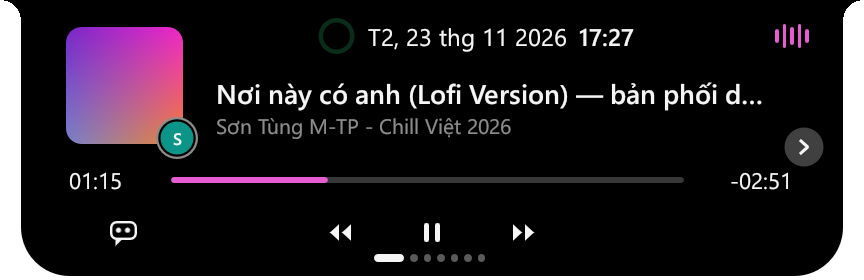

</div>

---

## Sommaire

- [Points forts](#points-forts)
- [Prise en main](#prise-en-main)
- [Les pages](#les-pages)
- [Pop-ups système](#pop-ups-système)
- [Outils rapides](#outils-rapides)
- [Paramètres généraux](#paramètres-généraux)
- [Performances](#performances)
- [Installation](#installation)
- [Réseau et confidentialité](#réseau-et-confidentialité)
- [Compiler depuis les sources](#compiler-depuis-les-sources)

## Points forts

| | |
|---|---|
| 🎵 **Music** | Vraie pochette, paroles qui suivent la chanson, couleurs tirées de la pochette |
| ⏱️ **Pomodoro** | 4 cycles, passer, enchaînement automatique, concentration au calme |
| 💧 **Water** | Rappels pour boire sur une plage horaire, annuler, 60 jours d'historique |
| 📁 **Shelf & Clipboard** | Garde fichiers et textes copiés, à glisser dans une conversation ; jamais de mots de passe |
| ✅ **To-do & Google Agenda** | Tâches à heure fixe, événements du jour, rappel 10 minutes avant |
| 📝 **Note** | Notes de travail rapides : épingler, terminer, copier ou glisser, `Ctrl + Alt + N` |
| 🕌 **Prayer** | Heures de prière avec 11 méthodes, arc solaire, date hégirienne |
| 🧩 **Widgets** | Météo, horloge mondiale, compte à rebours (y compris Tết), batterie, lune… |
| 🔔 **Pop-ups** | Volume, batterie, Wi-Fi, casque, lecture en cours, notifications Windows |
| 💬 **Demander à Nusa** | Calculatrice, conversion de devises, questions à Gemini, traduction, texte à l'écran |

## Prise en main

| Pour… | Faites ceci |
|---|---|
| Ouvrir l'encoche | Survolez l'encoche (ou cliquez, voir Settings › Open the notch on) |
| Changer de page | Les flèches de chaque côté, les points de page, la molette / le pavé tactile, ou les touches ← → |
| Ouvrir les paramètres | Clic droit sur l'encoche (encore un clic droit pour fermer) |
| Demander, calculer, traduire | `Ctrl + Alt + Space` |
| Copier du texte à l'écran (OCR) | `Ctrl + Alt + T`, puis sélectionnez une zone |
| Écrire une note rapide | `Ctrl + Alt + N` |
| Menu de la zone de notification | Clic droit sur l'icône : Start with Windows, Mascot, Minimal notch, About, Exit |

<table>
<tr>
<td align="center"><br><sub>Réduite pendant la musique</sub></td>
<td align="center">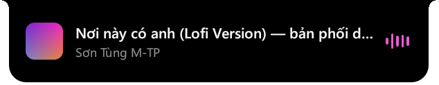<br><sub>Pop-up « Lecture en cours » au changement de morceau</sub></td>
</tr>
</table>

<details>
<summary><b>L'encoche au repos, la mascotte et les modes</b></summary>

- **Mascotte :** deux yeux blancs avec un halo, qui clignent environ toutes les 4 secondes ; une bande
  lumineuse turquoise, bleue et violette sur la moitié basse, qui suit les coins de l'encoche.
- **Minimal notch :** quand il ne se passe rien (pas de mascotte, pas de Pomodoro, pas de musique),
  l'encoche se réduit à un trait fin ; survolez-la pour la faire revenir.
- **Musique en cours :** l'encoche réduite affiche une petite pochette, l'heure et une onde sonore aux
  couleurs de la pochette, à la place de la mascotte.
- **Pomodoro en cours :** l'encoche au repos affiche un compte à rebours violet.
- L'encoche se referme seule quand la souris s'en va, sauf pendant la saisie.
- **Masquée en plein écran** (jeux, vidéos, diaporamas), elle revient à la sortie ; désactivable dans
  Settings › Popups.
- **Premier lancement :** l'encoche dit bonjour et montre comment l'ouvrir et accéder aux paramètres. Si
  une autre application a pris un raccourci, l'encoche le signale ; l'état est visible dans Settings › General.
- **Une seule instance :** relancer l'exe ouvre l'encoche déjà active au lieu d'en créer une deuxième.

</details>

## Les pages

Réordonnez ou masquez les pages dans **Settings › Pages**.

### 🎵 Music

- Le morceau joué par tout lecteur compatible avec les contrôles multimédias de Windows (Spotify,
  navigateurs…) : **vraie pochette**, titre, artiste – album, durée.
- L'icône de l'application en lecture est dans le coin de la pochette ; avec plusieurs lecteurs ouverts,
  cliquez dessus pour changer.
- Lecture/Pause, précédent/suivant (pour les lecteurs sans précédent/suivant, comme une vidéo YouTube
  seule, ces boutons reculent/avancent de 10 secondes), cliquez ou faites glisser la barre de
  progression pour vous déplacer. La barre et l'onde prennent la couleur de la pochette.
- **Paroles qui suivent la chanson** (LRCLIB) ; cliquez sur une ligne pour y aller. Affichez-les ou
  masquez-les avec le bouton paroles de la page, ou désactivez-les dans Settings › Music.

### ⏱️ Pomodoro

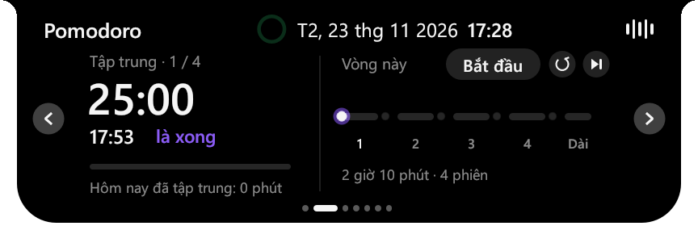

- Start / Pause / Resume (ou la touche **Espace**), 4 cycles de concentration puis une longue pause,
  des pauses courtes entre les deux.
- **↺** relance la partie en cours (à l'arrêt : recommence au cycle 1) ; **▶|** passe à la partie suivante.
- À la fin, un pop-up Break / Focus et un carillon (si activé). La page indique l'heure de fin, la bande
  des 4 cycles et les minutes de concentration du jour.
- Settings › Pomodoro : durée de chaque partie, **enchaînement automatique**, **concentration au calme**
  (les notifications attendent la fin de la concentration).
- Les cycles reviennent à 0 chaque jour ; le minuteur se met en pause quand le PC dort.

### 💧 Water

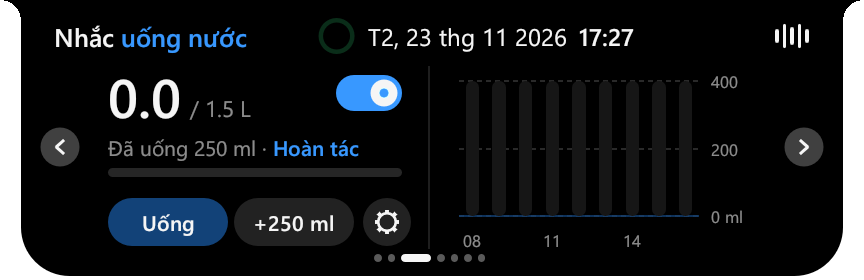

- Une barre de progression et une ligne comme « Aujourd'hui · 45 % · prochain 14:30 », un histogramme
  par heure, un interrupteur pour les rappels.
- **Boire** (une part égale de l'objectif selon le nombre de rappels) et **+250 ml** (un verre) ; juste
  après, **Annuler** reste disponible 10 secondes.
- Le bouton engrenage : objectif 1–4 L (par pas de 0,25 L), contenance de la gourde, plage des rappels,
  Reset (deux appuis en 3 secondes).
- Le pop-up de rappel propose Drank / Snooze (5 / 10 / 15 minutes) ; quand la gourde est presque vide, il
  propose de la remplir (Refilled). Un rappel manqué est rattrapé avant le suivant.
- La quantité bue chaque jour est gardée 60 jours ; le widget Water montre les 7 derniers jours.

### 📁 Shelf et Clipboard

- **Shelf :** déposez des fichiers n'importe où sur l'encoche ; cliquez pour ouvrir, faites glisser vers
  un dossier ou une conversation, clic droit pour retirer, Clear pour tout vider. Avec beaucoup de
  fichiers, ça défile horizontalement ; les fichiers déplacés ou supprimés sont grisés.
- **Clipboard** (bouton dans le coin) : historique des textes copiés, 1 à 5 éléments ; cliquez pour
  recopier, faites glisser dans une conversation, clic droit pour supprimer un élément.
- 🔒 Les **mots de passe** et ce qu'un gestionnaire de mots de passe marque « hors historique » ne sont
  **jamais enregistrés**.

### ✅ To-do et Google Agenda

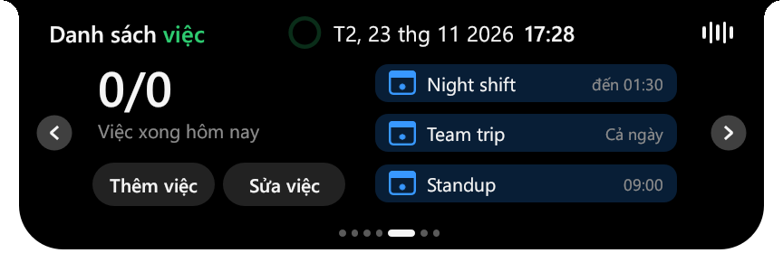

- Tâches avec une heure (HH:MM, vide s'il n'y a pas d'heure) et une durée ; cliquez pour marquer comme
  faite (pour la journée, elle se rouvre le lendemain) ; « Edit Task » pour modifier ou supprimer.
- Un rappel au début et à la fin, une fois par jour, avec un bouton **Later** (5 / 10 / 15 minutes).
- **Google Agenda :** collez l'*Adresse secrète au format iCal* de votre agenda dans Settings › Google
  Calendar (chiffrée, gardée sur ce PC uniquement). Les événements du jour s'affichent en haut de To-do
  (lecture seule), avec un rappel 10 minutes avant (désactivable) et au début ; les événements
  récurrents, déplacés ou annulés et ceux qui passent minuit sont gérés. Relu toutes les 15 minutes.

### 📝 Note

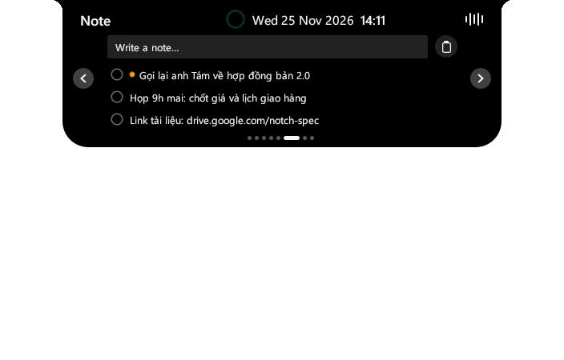

- Écrivez une note puis **Entrée** ; le bouton à côté du champ transforme le texte que vous venez de
  copier en note (pas un texte marqué privé, comme pour le Clipboard).
- **Cliquez** sur une note pour la copier, **faites-la glisser** dans une conversation ou un dossier,
  cliquez sur son **cercle** pour la terminer (barrée, supprimée 3 jours plus tard) ; **clic droit**
  pour épingler, terminer ou supprimer.
- **Choisir** coche plusieurs notes à supprimer d'un coup (**Tout choisir**, puis **Supprimer** deux
  fois pour confirmer). Réglages › Notes : durée de conservation des notes terminées (1 / 3 / 7 jours
  ou jamais) et affichage de l'heure de chaque note.
- **`Ctrl + Alt + N`** ouvre cette page avec le curseur dans le champ, de n'importe où.
- Les notes épinglées d'abord, puis les plus récentes ; jusqu'à 200 notes de 500 caractères au plus,
  gardées dans `notes.txt`.

### 🕌 Prayer

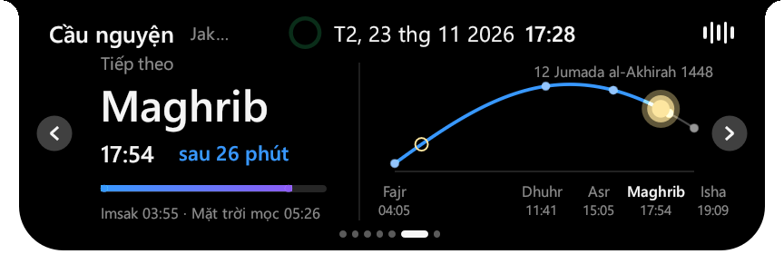

- À activer dans Settings › Prayer times. 84 villes d'Indonésie, 28 villes du monde (heure locale, avec
  l'heure d'été) et **My location** (localisation Windows).
- 11 méthodes de calcul (Kemenag, MWL, ISNA, Egypt, Umm al-Qura, Karachi, JAKIM, MUIS, Diyanet, UOIF,
  Gulf) ou selon la ville ; Asr selon la méthode, Shafi'i ou Hanafi.
- La prochaine prière et le temps restant, l'Imsak et le lever du soleil, la **date hégirienne**, un arc
  avec les 5 prières et le soleil. Les noms des prières suivent la langue de l'application.
- Un rappel à l'heure et 10 minutes avant (un rappel manqué est rattrapé dans les 30 minutes), la musique
  se met en pause et peut reprendre après 10 minutes, chaque prière se décale de ±10 minutes.

### 🧩 Widgets

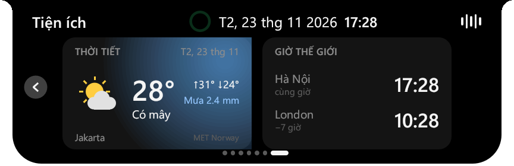

Deux widgets à la fois, à choisir parmi 10 dans Settings › Widgets : **This week, Battery, Next prayer,
Focus today, World clock, Moon, Countdown, Water, Weather, Devices**. Cliquez sur les widgets Semaine, Prière,
Concentration ou Eau pour ouvrir la page correspondante.

<details>
<summary><b>Détails des widgets</b></summary>

- **World clock :** 2 villes parmi 27 (dont Hanoï, Hô Chi Minh-Ville, Bangkok…), avec le décalage horaire
  par rapport à ce PC.
- **Countdown :** Nouvel An, Ramadan, Aïd al-Fitr, Aïd al-Adha, fête de l'Indépendance indonésienne,
  Noël, **Nouvel An lunaire (Tết)**, **fête nationale du Viêt Nam**, ou **votre propre date** (nom au
  choix, JJ/MM chaque année ou JJ/MM/AAAA).
- **Weather** (MET Norway, relu toutes les 30 minutes) : température, ciel, max/min du jour, pluie dans
  les 6 prochaines heures, °C ou °F.
- **Devices :** jusqu'à trois appareils Bluetooth connectés (casques, souris, claviers, manettes)
  et les manettes Xbox, avec leur batterie ; en rouge quand elle est faible.
- **Week starts on :** dimanche ou lundi.

</details>

### 📰 Today

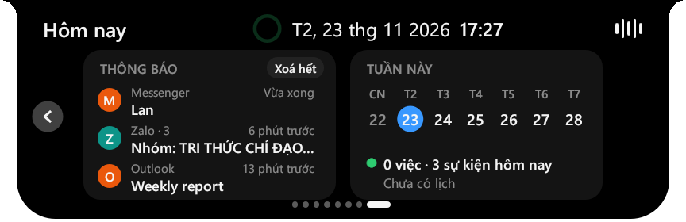

- À activer dans Settings › Notifications › Today page (ou Settings › Pages).
- À gauche : jusqu'à 20 notifications récentes, avec défilement, **une ligne par application** avec son
  logo et le nombre (« Zalo · 3 ») ; cliquez pour ouvrir l'application d'origine, clic droit pour
  supprimer, Clear pour tout vider. Gardées en mémoire seulement, perdues à la fermeture.
- À droite : la semaine, le nombre de tâches et d'événements Google Agenda du jour, la prochaine tâche
  ou le prochain événement.

## Pop-ups système

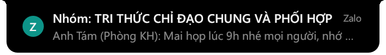

Activez ou désactivez chaque type dans **Settings › Popups**.

| Pop-up | Quand |
|---|---|
| 🔊 Volume · ☀️ Luminosité | Au changement de niveau |
| ⇪ Verr. Maj · ⌨️ Langue du clavier | À l'activation/désactivation, au changement de clavier |
| 🔋 Batterie | Chargeur branché / débranché, batterie faible (15 / 20 / 30 %, au choix), très faible (moins de 11 %), chargée ; sur batterie, le pop-up et le widget Battery affichent le temps restant |
| 📶 Wi-Fi | Connecté, déconnecté, connecté sans internet |
| 🎧 Appareils Bluetooth · 🎮 Manettes Xbox | Casques, souris, claviers, manettes : connecté (avec le % de batterie), déconnecté, batterie faible |
| 🎵 Lecture en cours | Changement de morceau pendant que l'encoche est réduite |
| 🔔 Notifications Windows | Logo de l'application, expéditeur et texte (si l'aperçu est activé), regroupées en « +N » ; cliquez pour ouvrir la bonne application |

## Outils rapides

### 💬 Demander à Nusa — `Ctrl + Alt + Space`

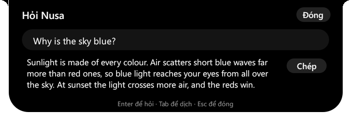

| Saisie | Résultat |
|---|---|
| `12*(3+4)=` | **Calculé aussitôt** en tapant `=` (ou Entrée), sans internet. `+ − × ÷ ^ %`, parenthèses, nombres négatifs. |
| `1.000.000 / 4`, `2,500,000 + 1`, `1,5 * 2` | Séparateurs de milliers et décimales, à la vietnamienne comme à l'anglaise. |
| `500k`, `2tr`, `2 triệu`, `1 tỷ` | Abréviations vietnamiennes des grands montants (mille, million, milliard). |
| `100usd to vnd=`, `500k vnd to usd`, `1,5 eur in jpy` | **Conversion de devises** (Entrée ajoute le `=`) ; taux gardés 12 heures. |
| Une question + **Entrée** | Interroge **Gemini**, 3 phrases courtes au plus, dans la langue de la question. |
| Un texte + **Tab** | **Traduit** dans la langue de l'application (un texte déjà dans cette langue part en anglais). |

- Le bouton **Copier** copie le résultat ou la réponse ; **↑ / ↓** rappellent les questions précédentes
  (jusqu'à 20, en mémoire seulement) ; **Échap** ferme.
- Gemini et la traduction demandent votre propre clé Gemini (gratuite sur
  [aistudio.google.com/apikey](https://aistudio.google.com/apikey)), à coller dans Settings › Ask Nusa ;
  la clé est chiffrée sur ce PC. Clé erronée, trop de requêtes ou pas d'internet : tout est clairement signalé.

### 🔍 Copier du texte à l'écran — `Ctrl + Alt + T`

L'écran se fige ; sélectionnez une zone et son texte est copié (« N caractères copiés ») ; **Échap** ou
clic droit pour annuler. La lecture se fait sur ce PC, sans internet, dans les langues installées dans
Windows (pour lire une langue, installez son module dans Settings › Time & language › Language).

**Langues de l'interface :** English, Tiếng Việt, 中文 (简体), Français.

## Paramètres généraux

Clic droit sur l'encoche pour ouvrir, **Échap** ou **Close** pour fermer. Chaque changement est enregistré
aussitôt et conservé après un redémarrage.

| Élément | Choix |
|---|---|
| Language | English, Tiếng Việt, 中文 (简体), Français (la première fois, suit la langue de Windows) |
| Start with Windows | Affiche l'état réel, même désactivé depuis le Gestionnaire des tâches ; se met à jour si l'application change de dossier |
| Size | Small 100 % · Medium 115 % · Large 130 % · Extra large 150 % |
| Show date and time | Masque l'horloge sur l'encoche et en haut des pages (un Pomodoro en cours reste affiché) |
| Tray icon | Violet · Neon dark · Classic light |
| Minimal notch · Mascot | Activé/désactivé (aussi dans le menu de la zone de notification) |
| Reduce motion | Sans glissement ni rebond (la première fois, suit les effets d'animation de Windows) |
| Open the notch on | Survol · Clic |
| Status ring | Water · Tâches faites aujourd'hui · Aucun anneau |
| Reminder sounds | Carillon pour Pomodoro, To-do, Water |
| Pages | ↑ ↓ pour réordonner, interrupteur pour masquer (au moins 1 page reste toujours) |
| Données | **Ouvrir** le dossier des données · **Restaurer** les paramètres par défaut (deux appuis ; eau, tâches, historique, clés et agenda sont conservés) · **Vérifier** les nouvelles versions sur GitHub (ou chaque jour, désactivé par défaut) |

Les données sont dans `%LOCALAPPDATA%\MyNotch` : `settings.txt`, `water.txt`, `water_log.txt`,
`tasks.txt`, `focus.txt`, `shelf.txt`, `notes.txt`, `clipboard.txt` (seulement avec « Remember after restart »). La clé
Gemini et l'adresse de l'agenda sont à part dans `gemini.key` et `calendar.key`, chiffrées avec DPAPI de
Windows.

## Performances

L'encoche ne se redessine que lorsque quelque chose change (un événement Windows, la minute suivante, le
clignement de la mascotte) : elle sollicite à peine votre PC.

| État | CPU | Mémoire (Gestionnaire des tâches) |
|---|---|---|
| Au repos (encoche réduite) | ~0 % | environ 20–30 Mo |
| Ouverte | moins de 1 % | jusqu'à environ 65 Mo, redescend à la fermeture |

<sub>Mesuré sur un PC avec la version release après 6 heures de fonctionnement. La mémoire augmente un
peu avec les pochettes et les logos d'applications.</sub>

## Installation

1. Téléchargez `MyNotch-<version>-windows-x64.zip` depuis **[Releases](https://github.com/PhamDoanTrungDuong/Dynamik/releases/latest)**.
2. Décompressez-le et double-cliquez sur **`install.cmd`** (pas besoin des droits administrateur).
   L'application est copiée dans `%LOCALAPPDATA%\Programs\MyNotch` et un raccourci « My Notch » est
   ajouté au menu Démarrer.
3. Si Windows affiche *« Windows a protégé votre ordinateur »* : cliquez sur **Informations
   complémentaires → Exécuter quand même** (l'application n'est pas encore signée).

> **Vérifier un téléchargement :** chaque version a un `SHA256SUMS.txt` ; comparez-le avec
> `(Get-FileHash MyNotch-<version>-windows-x64.zip).Hash` dans PowerShell.
>
> **Mise à jour :** quittez l'encoche en cours (icône › Exit), puis lancez le `install.cmd` de la
> nouvelle version.
>
> **Désinstallation :** lancez `%LOCALAPPDATA%\Programs\MyNotch\uninstall.cmd`. Vos paramètres sont dans
> `%LOCALAPPDATA%\MyNotch` ; supprimez ce dossier pour tout effacer.

## Réseau et confidentialité

L'application fonctionne entièrement sur votre PC, sauf pour les fonctions ci-dessous ; chacune ne se
connecte que lorsque vous l'utilisez.

| Fonction | Envoie à | Quoi |
|---|---|---|
| Paroles | [LRCLIB](https://lrclib.net) | Titre et artiste |
| Météo | [MET Norway](https://api.met.no) | Coordonnées de la ville choisie (arrondies à ~1 km) |
| Devises | [open.er-api.com](https://open.er-api.com) | Rien d'autre que la demande de taux |
| Demander à Nusa / Traduire | Google Gemini | La question ou le texte à traduire, avec votre clé |
| Google Agenda | Google | Lit votre agenda via votre adresse iCal secrète |
| Mises à jour | GitHub | Demande la dernière version, seulement quand vous vérifiez (ou chaque jour si activé) |

- 🔐 La clé Gemini et l'adresse de l'agenda sont **chiffrées par Windows** (DPAPI) ; seul ce compte
  Windows sur ce PC peut les lire.
- 📋 Le presse-papiers ne garde jamais de mots de passe ; les notifications de la page Today restent en
  mémoire seulement.
- ⌨️ Pour afficher les pop-ups Verr. Maj / langue du clavier, l'application surveille ces touches (codes
  de touche uniquement, rien n'est enregistré) ; certains antivirus peuvent le signaler.

## Compiler depuis les sources

Il faut [Rust](https://rustup.rs) (stable, cible `x86_64-pc-windows-msvc`).

```sh
cd app
cargo build --release      # app/target/release/notch.exe
cargo test --release
```

<details>
<summary><b>Icône et paquet de publication</b></summary>

- L'icône de l'exe est intégrée avec `windres` (par exemple de LLVM-MinGW) s'il est dans le PATH ; sans
  lui, l'exe se compile quand même, simplement sans icône. Les ébauches d'icônes sont dans `icon-options/`.
- Paquet : copiez `app/target/release/notch.exe` sous le nom `MyNotch.exe` dans un dossier `MyNotch/`
  avec les trois fichiers de `packaging/` (`install.cmd`, `uninstall.cmd`, `HUONG-DAN.txt`), puis
  compressez ce dossier en `MyNotch-<version>-windows-x64.zip`.

</details>

---

<div align="center">
<sub>Une reconstruction indépendante inspirée de l'application Nusa ; sans lien avec l'auteur de Nusa.
<code>app/MECHANICS.md</code> (en vietnamien) décrit le fonctionnement de chaque fonction.</sub>
</div>
