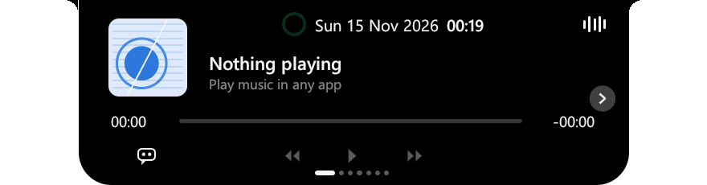

# Dynamik — My Notch

A Dynamic Island–style notch for Windows 10/11, written in Rust (egui). It sits at the top edge of the
screen, shows what's going on, and opens into a small panel of tools.

*Một "notch" kiểu Dynamic Island cho Windows 10/11, viết bằng Rust. Notch nằm ở mép trên màn hình,
hiện trạng thái và mở ra thành bảng công cụ nhỏ.*



## Tính năng

**Notch**
- Notch nghỉ có mascot: 2 mắt trắng có quầng sáng, khoảng 4 giây chớp một lần; dải sáng xanh ngọc,
  xanh dương, tím ở nửa dưới, bo theo góc notch.
- Minimal notch: khi không có việc gì (không mascot, không Pomodoro, không phát nhạc), notch thu thành
  một vạch mỏng; rê chuột vào thì bung ra.
- Khi đang Pomodoro: notch nghỉ hiện đồng hồ đếm ngược màu tím, thay chỗ mascot.
- Mở notch: rê chuột vào, hoặc click (Settings › Open the notch on). Chuột rời đi thì notch tự thu lại,
  trừ khi đang gõ chữ.
- Chuyển trang: mũi tên hai bên, chấm trang, lăn chuột (hoặc vuốt touchpad), hoặc phím ← → khi không
  gõ chữ; trang trượt ngang và mờ dần. Trên danh sách To-do, lăn chuột để cuộn danh sách.
- Lần đầu mở app: notch chào và chỉ cách mở, cách vào Settings.
- Phím tắt bị app khác chiếm thì notch báo một lần; trạng thái phím tắt xem ở Settings › General.
- Settings: click phải vào notch để mở, click phải lần nữa để đóng.
- Menu khay hệ thống: Start with Windows, Mascot, Minimal notch (có dấu tick), About, Exit. Click trái
  để mở notch.
- Ẩn khi toàn màn hình (game, video, slide), thoát ra thì notch hiện lại; tắt được ở Settings › Popups.
- Chỉ chạy một bản: mở exe lần nữa thì notch đang chạy sẽ mở ra, không tạo notch thứ hai.

**Các trang** (sắp xếp lại hoặc ẩn trong Settings › Pages)
- **Music**: bài đang phát từ trình phát hỗ trợ điều khiển nhạc của Windows (Spotify, trình duyệt…):
  ảnh bìa thật, tên bài, ca sĩ – album, thời gian; icon app đang phát ở góc ảnh bìa (mở nhiều trình
  phát thì bấm icon để chuyển). Play/pause, bài trước/sau, click hoặc kéo thanh tiến trình để tua;
  thanh tiến trình và sóng nhạc lấy màu ảnh bìa. **Lời bài hát chạy theo nhạc** từ LRCLIB (bật/tắt
  bằng nút lời trên trang, tắt hẳn ở Settings › Music), click một dòng để nhảy tới. Notch thu nhỏ khi
  đang phát hiện ảnh bìa nhỏ, giờ và sóng nhạc.
- **Pomodoro**: Start / Pause / Resume (hoặc phím Space), 4 vòng tập trung rồi nghỉ dài, nghỉ ngắn
  giữa các vòng. Nút ↺ chạy lại phần đang chạy (bấm khi chưa chạy: bắt đầu lại từ vòng 1), nút ▶| bỏ
  qua sang phần kế tiếp. Hết giờ có pop-up với nút Break / Focus và chuông (nếu bật). Trang hiện giờ
  sẽ xong, dải 4 vòng và số phút đã tập trung hôm nay. Settings › Pomodoro: thời lượng từng phần, tự
  chạy tiếp, tập trung yên tĩnh (thông báo chờ đến khi hết giờ tập trung). Số vòng về 0 khi sang ngày
  mới; máy ngủ thì đồng hồ tạm dừng.
- **Water**: thanh tiến độ và dòng "Hôm nay · 45% · lần tới 14:30", biểu đồ cột theo giờ, công tắc
  bật/tắt nhắc. Nút Uống (lượng chia đều theo mục tiêu và số lần nhắc), +250 ml (một cốc); vừa bấm
  thì có Hoàn tác trong 10 giây. Nút bánh răng trên trang: mục tiêu 1–4 L (bước 0,25 L), dung tích
  bình, khung giờ nhắc, Reset (bấm 2 lần trong 3 giây). Pop-up nhắc có Drank / Snooze; bình gần cạn
  thì nhắc đổ đầy (Refilled). Snooze 5 / 10 / 15 phút ở Settings › Water reminders. Lỡ một lần nhắc
  (đang có pop-up khác, máy ngủ, chơi game) thì được nhắc bù trước lần kế tiếp. Lượng nước mỗi ngày
  được lưu 60 ngày; widget Water hiện 7 ngày gần nhất. Vòng tiến độ ở notch: Settings › Status ring.
- **Shelf**: kéo file vào notch, kéo ra thư mục hoặc ô chat; lịch sử clipboard.
- **To-do**: việc có giờ, nhắc khi bắt đầu và khi hết giờ, nút "Later".
- **Prayer**: giờ cầu nguyện trên vòng cung mặt trời, nhắc giờ, tự dừng nhạc.
- **Widgets**: 2 widget một lúc — tuần, pin, giờ cầu nguyện, focus, giờ thế giới, mặt trăng, đếm ngược,
  nước, thời tiết.
- **Today**: thông báo gần đây và tuần của bạn.

**Pop-up hệ thống**: âm lượng, độ sáng, Caps Lock, ngôn ngữ bàn phím, pin, Wi-Fi, tai nghe Bluetooth,
thông báo Windows.

**Công cụ nhanh**
- `Ctrl + Alt + Space`: ô hỏi nhanh — tính toán (`12*(3+4)=`) và đổi tiền (`100usd to vnd=`).
- `Ctrl + Alt + T`: OCR — kéo chọn một vùng màn hình, chữ trong đó được đọc (offline) và copy.

**Ngôn ngữ**: English, Tiếng Việt, 中文 (简体), Français.

## Cài đặt

1. Tải `MyNotch-<version>-windows-x64.zip` ở trang [Releases](https://github.com/PhamDoanTrungDuong/Dynamik/releases).
2. Giải nén, bấm đúp `install.cmd` (không cần quyền admin). App được chép vào
   `%LOCALAPPDATA%\Programs\MyNotch` và có lối tắt "My Notch" trong Start Menu.
3. Nếu Windows hiện "Windows protected your PC": bấm **More info → Run anyway** (app chưa có chữ ký số).

Gỡ cài đặt: chạy `%LOCALAPPDATA%\Programs\MyNotch\uninstall.cmd`. Cài đặt riêng nằm ở
`%LOCALAPPDATA%\MyNotch`.

## Build từ mã nguồn

Cần [Rust](https://rustup.rs) (stable, target `x86_64-pc-windows-msvc`).

```sh
cd app
cargo build --release      # app/target/release/notch.exe
cargo test --release
```

Icon của exe được nhúng bằng `windres` (ví dụ từ LLVM-MinGW) nếu có trong PATH; không có thì exe vẫn
build được, chỉ thiếu icon. Các mẫu icon nằm trong `icon-options/`.

Đóng gói bản phát hành: chép `app/target/release/notch.exe` thành `MyNotch.exe` vào một thư mục
`MyNotch/` cùng ba file trong `packaging/` (`install.cmd`, `uninstall.cmd`, `HUONG-DAN.txt`), rồi nén
thư mục đó thành `MyNotch-<version>-windows-x64.zip`.

## Mạng và quyền riêng tư

App chạy hoàn toàn trên máy, trừ các tính năng sau (đều miễn phí, không cần khóa, chỉ gọi khi dùng):
- Lời bài hát: [LRCLIB](https://lrclib.net) (gửi tên bài và ca sĩ).
- Thời tiết: [MET Norway](https://api.met.no) (gửi tọa độ thành phố đã chọn).
- Tỉ giá: [open.er-api.com](https://open.er-api.com).

Để hiện pop-up Caps Lock / đổi ngôn ngữ bàn phím, app theo dõi các phím đó (chỉ xem mã phím, không ghi
lại gì); một số phần mềm diệt virus có thể cảnh báo vì việc này.

## Ghi chú

Đây là bản dựng lại độc lập, lấy cảm hứng từ app Nusa; không liên kết với tác giả của Nusa.
`app/MECHANICS.md` ghi lại cách từng tính năng hoạt động.
