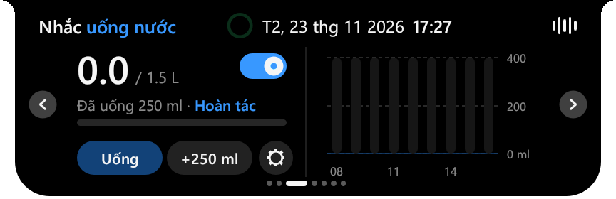

<div align="center">

# Dynamik — My Notch

**Một "notch" kiểu Dynamic Island cho Windows 10/11.**
Nằm gọn ở mép trên màn hình, báo những gì đang diễn ra và mở ra thành một bảng công cụ nhỏ.

*A Dynamic Island–style notch for Windows 10/11, written in Rust (egui).*

[](https://github.com/PhamDoanTrungDuong/Dynamik/releases/latest)


**[⬇ Tải bản mới nhất](https://github.com/PhamDoanTrungDuong/Dynamik/releases/latest)**


</div>

---

## Mục lục

- [Điểm nổi bật](#điểm-nổi-bật)
- [Dùng nhanh](#dùng-nhanh)
- [Các trang](#các-trang)
- [Pop-up hệ thống](#pop-up-hệ-thống)
- [Công cụ nhanh](#công-cụ-nhanh)
- [Settings chung](#settings-chung)
- [Cài đặt](#cài-đặt)
- [Mạng và quyền riêng tư](#mạng-và-quyền-riêng-tư)
- [Build từ mã nguồn](#build-từ-mã-nguồn)

## Điểm nổi bật

| | |
|---|---|
| 🎵 **Music** | Ảnh bìa thật, lời bài hát chạy theo nhạc, màu theo ảnh bìa |
| ⏱️ **Pomodoro** | 4 vòng, bỏ qua, tự chạy tiếp, tập trung yên tĩnh |
| 💧 **Water** | Nhắc uống nước theo khung giờ, hoàn tác, lịch sử 60 ngày |
| 📁 **Shelf & Clipboard** | Giữ file và chữ đã copy, kéo ra ô chat; không lưu mật khẩu |
| ✅ **To-do & Google Lịch** | Việc có giờ, sự kiện lịch hôm nay, nhắc trước 10 phút |
| 🕌 **Prayer** | Giờ cầu nguyện 11 phương pháp, vòng cung mặt trời, Hồi lịch |
| 🧩 **Widgets** | Thời tiết, giờ thế giới, đếm ngược (có Tết), pin, mặt trăng… |
| 🔔 **Pop-up** | Âm lượng, pin, Wi-Fi, tai nghe, đang phát, thông báo Windows |
| 💬 **Hỏi Nusa** | Tính toán, đổi tiền, hỏi Gemini, dịch, lấy chữ trên màn hình |

## Dùng nhanh

| Muốn… | Làm thế này |
|---|---|
| Mở notch | Rê chuột lên notch (hoặc click, tùy Settings › Open the notch on) |
| Chuyển trang | Mũi tên hai bên, chấm trang, lăn chuột / vuốt touchpad, hoặc phím ← → |
| Mở Settings | Click phải vào notch (click phải lần nữa để đóng) |
| Hỏi nhanh, tính toán, dịch | `Ctrl + Alt + Space` |
| Lấy chữ trên màn hình (OCR) | `Ctrl + Alt + T`, rồi kéo chọn vùng |
| Menu khay hệ thống | Click phải icon ở khay: Start with Windows, Mascot, Minimal notch, About, Exit |

<table>
<tr>
<td align="center"><br><sub>Thu nhỏ khi đang phát nhạc</sub></td>
<td align="center"><br><sub>Pop-up "Đang phát" khi đổi bài</sub></td>
</tr>
</table>

<details>
<summary><b>Notch nghỉ, mascot và các chế độ</b></summary>

- **Mascot:** 2 mắt trắng có quầng sáng, khoảng 4 giây chớp một lần; dải sáng xanh ngọc, xanh dương, tím
  ở nửa dưới, bo theo góc notch.
- **Minimal notch:** khi không có việc gì (không mascot, không Pomodoro, không phát nhạc), notch thu
  thành một vạch mỏng; rê chuột vào thì bung ra.
- **Đang phát nhạc:** notch thu nhỏ hiện ảnh bìa nhỏ, giờ và sóng nhạc màu ảnh bìa, thay chỗ mascot.
- **Đang Pomodoro:** notch nghỉ hiện đồng hồ đếm ngược màu tím.
- Chuột rời đi thì notch tự thu lại, trừ khi đang gõ chữ.
- **Ẩn khi toàn màn hình** (game, video, slide), thoát ra thì hiện lại; tắt được ở Settings › Popups.
- **Lần đầu mở:** notch chào và chỉ cách mở, cách vào Settings. Phím tắt bị app khác chiếm thì notch
  báo; xem trạng thái ở Settings › General.
- **Chỉ chạy một bản:** mở exe lần nữa thì notch đang chạy sẽ mở ra, không tạo notch thứ hai.

</details>

## Các trang

Sắp xếp lại hoặc ẩn từng trang trong **Settings › Pages**.

### 🎵 Music

- Bài đang phát từ trình phát hỗ trợ điều khiển nhạc của Windows (Spotify, trình duyệt…): **ảnh bìa
  thật**, tên bài, ca sĩ – album, thời gian.
- Icon app đang phát ở góc ảnh bìa; mở nhiều trình phát thì bấm icon để chuyển.
- Play/Pause, bài trước/sau (trình phát không có bài trước/sau, như một video YouTube lẻ, thì hai nút
  này tua lùi/tới 10 giây), click hoặc kéo thanh tiến trình để tua. Thanh tiến trình và sóng nhạc
  lấy màu ảnh bìa.
- **Lời bài hát chạy theo nhạc** (LRCLIB), click một dòng để nhảy tới. Bật/tắt bằng nút lời trên trang,
  tắt hẳn ở Settings › Music.

### ⏱️ Pomodoro


- Start / Pause / Resume (hoặc phím **Space**), 4 vòng tập trung rồi nghỉ dài, nghỉ ngắn giữa các vòng.
- **↺** chạy lại phần đang chạy (bấm khi chưa chạy: bắt đầu lại từ vòng 1); **▶|** bỏ qua sang phần
  kế tiếp.
- Hết giờ có pop-up Break / Focus và chuông (nếu bật). Trang hiện giờ sẽ xong, dải 4 vòng và số phút
  đã tập trung hôm nay.
- Settings › Pomodoro: thời lượng từng phần, **tự chạy tiếp**, **tập trung yên tĩnh** (thông báo chờ
  đến khi hết giờ tập trung).
- Số vòng về 0 khi sang ngày mới; máy ngủ thì đồng hồ tạm dừng.

### 💧 Water



- Thanh tiến độ và dòng "Hôm nay · 45% · lần tới 14:30", biểu đồ cột theo giờ, công tắc bật/tắt nhắc.
- Nút **Uống** (lượng chia đều theo mục tiêu và số lần nhắc) và **+250 ml** (một cốc); vừa bấm thì có
  **Hoàn tác** trong 10 giây.
- Nút bánh răng: mục tiêu 1–4 L (bước 0,25 L), dung tích bình, khung giờ nhắc, Reset (bấm 2 lần trong
  3 giây).
- Pop-up nhắc có Drank / Snooze (5 / 10 / 15 phút); bình gần cạn thì nhắc đổ đầy (Refilled). Lỡ một
  lần nhắc thì được nhắc bù trước lần kế tiếp.
- Lượng nước mỗi ngày được lưu 60 ngày; widget Water hiện 7 ngày gần nhất.

### 📁 Shelf và Clipboard

- **Shelf:** kéo file vào bất kỳ đâu trên notch; click để mở, kéo ra thư mục hoặc ô chat, click phải
  để gỡ, Clear xóa hết. Nhiều file thì cuộn ngang; file đã bị chuyển hoặc xóa hiện mờ.
- **Clipboard** (nút chuyển ở góc): lịch sử chữ đã copy, giữ 1–5 mục; click để copy lại, kéo vào ô
  chat, click phải để xóa một mục.
- 🔒 **Mật khẩu** và nội dung được trình quản lý mật khẩu đánh dấu "không lưu lịch sử" **không bao giờ
  được lưu**.

### ✅ To-do và Google Lịch


- Việc có giờ (HH:MM, để trống nếu không có giờ) và thời lượng; click để đánh dấu xong (tính trong
  ngày, sang ngày mới việc mở lại); "Edit Task" để sửa hoặc xóa.
- Nhắc khi bắt đầu và khi hết giờ, mỗi ngày một lần, nút **Later** (5 / 10 / 15 phút).
- **Google Lịch:** dán *Secret address in iCal format* của lịch vào Settings › Google Calendar (được mã
  hóa, chỉ lưu trên máy). Sự kiện hôm nay hiện đầu To-do (chỉ đọc), nhắc trước 10 phút (tắt được) và lúc
  bắt đầu; có sự kiện lặp lại, buổi bị dời hoặc hủy, sự kiện qua đêm. Đọc lại 15 phút một lần.

### 🕌 Prayer


- Bật trong Settings › Prayer times. 84 thành phố Indonesia, 28 thành phố thế giới (giờ địa phương,
  có giờ mùa hè) và **My location** (định vị Windows).
- 11 phương pháp tính (Kemenag, MWL, ISNA, Egypt, Umm al-Qura, Karachi, JAKIM, MUIS, Diyanet, UOIF,
  Gulf) hoặc theo thành phố; giờ Asr theo phương pháp, Shafi'i hoặc Hanafi.
- Giờ kế tiếp và còn bao lâu, Imsak và giờ mặt trời mọc, **ngày Hồi lịch**, vòng cung với 5 giờ và mặt
  trời. Tên giờ theo ngôn ngữ của app.
- Nhắc đúng giờ và trước 10 phút (lỡ thì nhắc bù trong 30 phút), tự dừng nhạc và có thể phát lại sau 10
  phút, chỉnh riêng từng giờ ±10 phút.

### 🧩 Widgets


Hai widget một lúc, chọn trong 9 loại ở Settings › Widgets: **This week, Battery, Next prayer, Focus
today, World clock, Moon, Countdown, Water, Weather**. Click widget Tuần, Giờ cầu nguyện, Tập trung, Nước
để mở trang tương ứng.

<details>
<summary><b>Chi tiết từng widget</b></summary>

- **World clock:** 2 thành phố trong 27 (có Hà Nội, TP. Hồ Chí Minh, Bangkok…), kèm chênh lệch giờ so
  với máy.
- **Countdown:** Năm mới, Ramadan, Eid al-Fitr, Eid al-Adha, Ngày Độc lập Indonesia, Giáng sinh, **Tết
  Nguyên Đán**, **Quốc khánh Việt Nam**, hoặc **ngày của bạn** (tên tự đặt, DD/MM hằng năm hoặc
  DD/MM/YYYY).
- **Weather** (MET Norway, đọc lại 30 phút một lần): nhiệt độ, trời, cao/thấp hôm nay, mưa 6 giờ tới,
  °C hoặc °F.
- **Week starts on:** Chủ nhật hoặc Thứ hai.

</details>

### 📰 Today


- Bật ở Settings › Notifications › Today page (hoặc Settings › Pages).
- Bên trái: tối đa 20 thông báo gần đây, cuộn được, **mỗi app một dòng** có logo và số tin
  ("Zalo · 3"); click để mở app đã gửi, click phải để xóa, Clear xóa hết. Chỉ giữ trong bộ nhớ, tắt app
  là mất.
- Bên phải: tuần này, số việc và sự kiện Google Lịch hôm nay, việc hoặc sự kiện kế tiếp.

## Pop-up hệ thống


Bật/tắt từng loại ở **Settings › Popups**.

| Pop-up | Khi nào |
|---|---|
| 🔊 Âm lượng · ☀️ Độ sáng | Khi đổi mức |
| ⇪ Caps Lock · ⌨️ Ngôn ngữ bàn phím | Khi bật/tắt, khi đổi bàn phím |
| 🔋 Pin | Cắm / rút sạc, pin yếu (15 / 20 / 30%, chọn được), pin rất yếu (dưới 11%), sạc đầy |
| 📶 Wi-Fi | Có mạng, mất mạng, có mạng nhưng không có internet |
| 🎧 Tai nghe Bluetooth | Kết nối (kèm % pin), ngắt kết nối, pin tai nghe yếu |
| 🎵 Đang phát | Đổi bài lúc notch thu nhỏ |
| 🔔 Thông báo Windows | Logo app, người gửi và nội dung (nếu bật preview), gom tin "+N"; click để mở đúng app |

## Công cụ nhanh

### 💬 Hỏi Nusa — `Ctrl + Alt + Space`


| Gõ | Ra |
|---|---|
| `12*(3+4)=` | **Tính ngay** khi gõ dấu `=` (hoặc Enter), không cần mạng. Có `+ − × ÷ ^ %`, ngoặc, số âm. |
| `1.000.000 / 4`, `2,500,000 + 1`, `1,5 * 2` | Hiểu số có dấu hàng nghìn và dấu thập phân kiểu Việt lẫn kiểu Anh. |
| `500k`, `2tr`, `2 triệu`, `1 tỷ` | Hiểu cách viết tắt số tiền lớn. |
| `100usd to vnd=`, `500k vnd to usd`, `1,5 eur in jpy` | **Đổi tiền** (Enter tự thêm `=`); tỉ giá giữ 12 giờ. |
| Câu hỏi bất kỳ + **Enter** | Hỏi **Gemini**, trả lời tối đa 3 câu ngắn, cùng ngôn ngữ câu hỏi. |
| Chữ bất kỳ + **Tab** | **Dịch** sang ngôn ngữ của app (chữ đã ở ngôn ngữ đó thì dịch sang tiếng Anh). |

- Nút **Chép** copy kết quả hoặc câu trả lời; phím **↑ / ↓** gọi lại các câu đã hỏi (tối đa 20, chỉ trong
  bộ nhớ); **Esc** để đóng.
- Hỏi Gemini và Dịch cần khóa Gemini riêng (miễn phí ở
  [aistudio.google.com/apikey](https://aistudio.google.com/apikey)), dán vào Settings › Ask Nusa; khóa
  được mã hóa trên máy. Khóa sai, hỏi nhiều quá hay mất mạng đều được báo rõ.

### 🔍 Lấy chữ trên màn hình — `Ctrl + Alt + T`

Màn hình đứng lại, kéo chọn một vùng thì chữ trong đó được copy (kèm "Đã copy N ký tự"); **Esc** hoặc
click phải để hủy. Đọc ngay trên máy, không cần mạng, theo các ngôn ngữ đã cài trong Windows (muốn đọc
tiếng Việt thì cài gói ngôn ngữ Tiếng Việt ở Settings › Time & language › Language).

**Ngôn ngữ giao diện:** English, Tiếng Việt, 中文 (简体), Français.

## Settings chung

Click phải vào notch để mở, **Esc** hoặc **Close** để đóng. Đổi gì là lưu ngay, mở lại app vẫn giữ.

| Mục | Chọn |
|---|---|
| Language | English, Tiếng Việt, 中文 (简体), Français (lần đầu theo ngôn ngữ Windows) |
| Start with Windows | Hiện đúng trạng thái thật, kể cả khi tắt từ Task Manager; app đổi chỗ thì tự trỏ lại |
| Size | Small 100% · Medium 115% · Large 130% · Extra large 150% |
| Show date and time | Tắt đồng hồ trên notch và đầu trang (Pomodoro đang chạy vẫn hiện) |
| Tray icon | Violet · Neon dark · Classic light |
| Minimal notch · Mascot | Bật/tắt (cũng có trong menu khay) |
| Open the notch on | Rê chuột · Click |
| Status ring | Water · Tasks done today · No ring |
| Reminder sounds | Chuông cho Pomodoro, To-do, Water |
| Pages | ↑ ↓ đổi thứ tự, công tắc để ẩn (luôn giữ ít nhất 1 trang) |
| Dữ liệu | **Mở** thư mục dữ liệu · **Khôi phục** cài đặt mặc định (bấm 2 lần; nước, việc, lịch sử, khóa và lịch vẫn giữ) |

Dữ liệu nằm ở `%LOCALAPPDATA%\MyNotch`: `settings.txt`, `water.txt`, `water_log.txt`, `tasks.txt`,
`focus.txt`, `shelf.txt`, `clipboard.txt` (chỉ khi bật "Remember after restart"). Khóa Gemini và địa
chỉ lịch nằm riêng trong `gemini.key` và `calendar.key`, được mã hóa bằng DPAPI của Windows.

## Cài đặt

1. Tải `MyNotch-<version>-windows-x64.zip` ở trang **[Releases](https://github.com/PhamDoanTrungDuong/Dynamik/releases/latest)**.
2. Giải nén, bấm đúp **`install.cmd`** (không cần quyền admin). App được chép vào
   `%LOCALAPPDATA%\Programs\MyNotch` và có lối tắt "My Notch" trong Start Menu.
3. Nếu Windows hiện *"Windows protected your PC"*: bấm **More info → Run anyway** (app chưa có chữ ký số).

> **Cập nhật:** thoát notch đang chạy (icon khay › Exit) rồi chạy `install.cmd` của bản mới.
>
> **Gỡ cài đặt:** chạy `%LOCALAPPDATA%\Programs\MyNotch\uninstall.cmd`. Cài đặt riêng của bạn nằm ở
> `%LOCALAPPDATA%\MyNotch`, xóa thư mục đó nếu muốn xóa sạch.

## Mạng và quyền riêng tư

App chạy hoàn toàn trên máy, trừ các tính năng dưới đây; mỗi cái chỉ gọi khi bạn dùng.

| Tính năng | Gửi tới | Gửi gì |
|---|---|---|
| Lời bài hát | [LRCLIB](https://lrclib.net) | Tên bài và ca sĩ |
| Thời tiết | [MET Norway](https://api.met.no) | Tọa độ thành phố đã chọn (làm tròn ~1 km) |
| Đổi tiền | [open.er-api.com](https://open.er-api.com) | Không gì ngoài yêu cầu tỉ giá |
| Hỏi Nusa / Dịch | Google Gemini | Câu hỏi hoặc chữ cần dịch, kèm khóa của bạn |
| Google Lịch | Google | Đọc lịch qua địa chỉ iCal bí mật của bạn |

- 🔐 Khóa Gemini và địa chỉ lịch được **mã hóa bằng Windows** (DPAPI), chỉ tài khoản Windows này trên máy
  này đọc được.
- 📋 Clipboard không lưu mật khẩu; thông báo trên trang Today chỉ giữ trong bộ nhớ.
- ⌨️ Để hiện pop-up Caps Lock / đổi ngôn ngữ bàn phím, app theo dõi các phím đó (chỉ xem mã phím, không
  ghi lại gì); một số phần mềm diệt virus có thể cảnh báo vì việc này.

## Build từ mã nguồn

Cần [Rust](https://rustup.rs) (stable, target `x86_64-pc-windows-msvc`).

```sh
cd app
cargo build --release      # app/target/release/notch.exe
cargo test --release
```

<details>
<summary><b>Icon và đóng gói bản phát hành</b></summary>

- Icon của exe được nhúng bằng `windres` (ví dụ từ LLVM-MinGW) nếu có trong PATH; không có thì exe vẫn
  build được, chỉ thiếu icon. Các mẫu icon nằm trong `icon-options/`.
- Đóng gói: chép `app/target/release/notch.exe` thành `MyNotch.exe` vào thư mục `MyNotch/` cùng ba file
  trong `packaging/` (`install.cmd`, `uninstall.cmd`, `HUONG-DAN.txt`), rồi nén thư mục đó thành
  `MyNotch-<version>-windows-x64.zip`.

</details>

---

<div align="center">
<sub>Bản dựng lại độc lập, lấy cảm hứng từ app Nusa; không liên kết với tác giả của Nusa.
<code>app/MECHANICS.md</code> ghi lại cách từng tính năng hoạt động.</sub>
</div>
