<div align="center">

<b>English</b> · <a href="README.vi.md">Tiếng Việt</a> · <a href="README.zh-CN.md">简体中文</a> · <a href="README.fr.md">Français</a>

# Dynamik — My Notch

**A Dynamic Island–style notch for Windows 10/11.**
It sits at the top edge of the screen, shows what's going on and opens into a small panel of tools.

*Written in Rust (egui).*

[](https://github.com/PhamDoanTrungDuong/Dynamik/releases/latest)


**[⬇ Download the latest version](https://github.com/PhamDoanTrungDuong/Dynamik/releases/latest)**

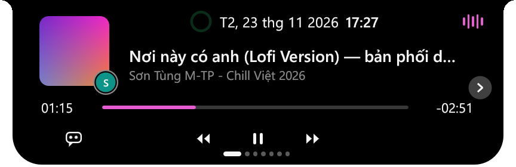

</div>

---

## Contents

- [Highlights](#highlights)
- [Quick start](#quick-start)
- [Pages](#pages)
- [System pop-ups](#system-pop-ups)
- [Quick tools](#quick-tools)
- [General settings](#general-settings)
- [Performance](#performance)
- [Installation](#installation)
- [Network and privacy](#network-and-privacy)
- [Building from source](#building-from-source)

## Highlights

| | |
|---|---|
| 🎵 **Music** | Real cover art, lyrics that follow the song, colours taken from the cover |
| ⏱️ **Pomodoro** | 4 rounds, skip, auto-continue, quiet focus |
| 💧 **Water** | Drink reminders within set hours, undo, 60 days of history |
| 📁 **Shelf & Clipboard** | Keep files and copied text, drag them into a chat box; passwords are never stored |
| ✅ **To-do & Google Calendar** | Timed tasks, today's calendar events, a reminder 10 minutes before |
| 📝 **Note** | Quick work notes: pin, mark done, copy or drag out, `Ctrl + Alt + N` |
| 🕌 **Prayer** | Prayer times with 11 methods, sun arc, Hijri date |
| 🧩 **Widgets** | Weather, world clock, countdown (including Tết), battery, moon… |
| 🔔 **Pop-ups** | Volume, battery, Wi-Fi, headset, now playing, Windows notifications |
| 💬 **Ask Nusa** | Calculator, currency conversion, ask Gemini, translate, grab text from the screen |

## Quick start

| To… | Do this |
|---|---|
| Open the notch | Hover the notch (or click it, see Settings › Open the notch on) |
| Change page | The arrows on either side, the page dots, mouse wheel / touchpad swipe, or the ← → keys |
| Open Settings | Right-click the notch (right-click again to close) |
| Ask, calculate, translate | `Ctrl + Alt + Space` |
| Grab text from the screen (OCR) | `Ctrl + Alt + T`, then drag over an area |
| Write a quick note | `Ctrl + Alt + N` |
| Tray menu | Right-click the tray icon: Start with Windows, Mascot, Minimal notch, About, Exit |

<table>
<tr>
<td align="center">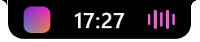<br><sub>Shrunk while music plays</sub></td>
<td align="center">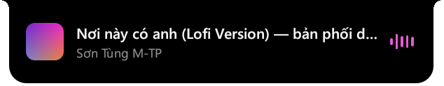<br><sub>"Now playing" pop-up when the song changes</sub></td>
</tr>
</table>

<details>
<summary><b>The resting notch, the mascot and the modes</b></summary>

- **Mascot:** two white eyes with a glow, blinking about every 4 seconds; a teal, blue and violet light
  strip along the lower half, following the notch's corners.
- **Minimal notch:** when nothing is going on (no mascot, no Pomodoro, no music), the notch shrinks to a
  thin line; hover it to bring it back.
- **Music playing:** the shrunk notch shows a small cover, the time and a sound wave in the cover's
  colour, in place of the mascot.
- **Pomodoro running:** the resting notch shows a violet countdown.
- The notch closes by itself when the mouse leaves, unless you are typing.
- **Hidden in full screen** (games, videos, slides) and back when you leave it; can be turned off in
  Settings › Popups.
- **First start:** the notch says hello and shows how to open it and how to reach Settings. If another
  app has taken a shortcut, the notch tells you; see the status in Settings › General.
- **One copy only:** starting the exe again opens the notch that is already running instead of a second one.

</details>

## Pages

Reorder or hide pages in **Settings › Pages**.

### 🎵 Music

- The song playing in any player that supports Windows media controls (Spotify, browsers…): **real
  cover art**, title, artist – album, time.
- The playing app's icon sits in the corner of the cover; with several players open, click it to switch.
- Play/Pause, previous/next (players without previous/next, such as a single YouTube video, get 10-second
  back/forward instead), click or drag the progress bar to seek. The progress bar and the sound wave take
  the cover's colour.
- **Lyrics that follow the song** (LRCLIB); click a line to jump to it. Toggle them with the lyrics button
  on the page, or turn them off for good in Settings › Music.

### ⏱️ Pomodoro

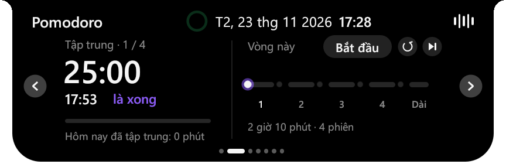

- Start / Pause / Resume (or the **Space** key), 4 focus rounds then a long break, short breaks in between.
- **↺** restarts the current part (when not running: starts over from round 1); **▶|** skips to the next part.
- When time is up there is a Break / Focus pop-up and a chime (if turned on). The page shows when the
  part ends, the 4-round strip and today's focus minutes.
- Settings › Pomodoro: length of each part, **auto-continue**, **quiet focus** (notifications wait until
  the focus time is over).
- Rounds reset to 0 on a new day; the timer pauses while the PC sleeps.

### 💧 Water


- A progress bar and a line such as "Today · 45% · next 14:30", an hourly bar chart, a reminder switch.
- **Drink** (an even share of the goal across the reminders) and **+250 ml** (one glass); right after a
  tap there is **Undo** for 10 seconds.
- The gear button: goal 1–4 L (in 0.25 L steps), bottle size, reminder hours, Reset (tap twice within
  3 seconds).
- The reminder pop-up has Drank / Snooze (5 / 10 / 15 minutes); when the bottle is nearly empty it asks
  you to refill it (Refilled). A missed reminder is made up before the next one.
- Each day's water is kept for 60 days; the Water widget shows the last 7 days.

### 📁 Shelf and Clipboard

- **Shelf:** drop files anywhere on the notch; click to open, drag out to a folder or a chat box,
  right-click to remove, Clear removes them all. Many files scroll sideways; files that were moved or
  deleted are dimmed.
- **Clipboard** (switch in the corner): history of copied text, keeps 1–5 items; click to copy again, drag
  into a chat box, right-click to delete one item.
- 🔒 **Passwords** and anything a password manager marks as "don't keep in history" are **never stored**.

### ✅ To-do and Google Calendar

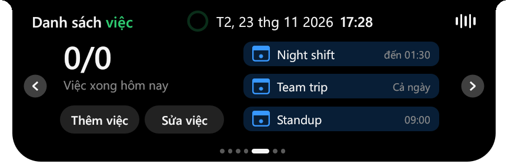

- Tasks with a time (HH:MM, leave empty for no time) and a length; click to mark done (for the day, it
  opens again on a new day); "Edit Task" to change or delete.
- A reminder at the start and at the end, once a day, with a **Later** button (5 / 10 / 15 minutes).
- **Google Calendar:** paste your calendar's *Secret address in iCal format* into Settings › Google Calendar
  (encrypted, kept on this PC only). Today's events show at the top of To-do (read-only), with a reminder
  10 minutes before (can be turned off) and at the start; repeating events, moved or cancelled ones and
  overnight events all work. Read again every 15 minutes.

### 📝 Note

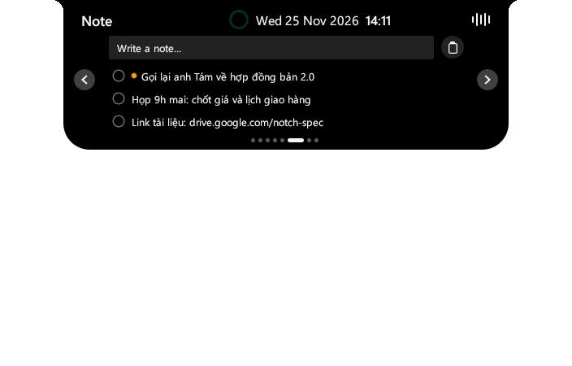

- Type a note and press **Enter**; the button beside the box turns the text you just copied into a
  note (not text marked private, as with the Clipboard).
- **Click** a note to copy it, **drag** it into a chat or a folder, click its **circle** to mark it
  done (struck through, removed 3 days later); **right-click** to pin, finish or delete.
- **Select** ticks notes to delete several at once (**Select all**, then **Delete** twice to
  confirm). Settings › Note: how long finished notes stay (1 / 3 / 7 days or never) and whether
  each note shows when it was written.
- **`Ctrl + Alt + N`** opens this page with the cursor in the box, from anywhere.
- Pinned notes first, then the newest; up to 200 notes of up to 500 characters, kept in `notes.txt`.

### 🕌 Prayer

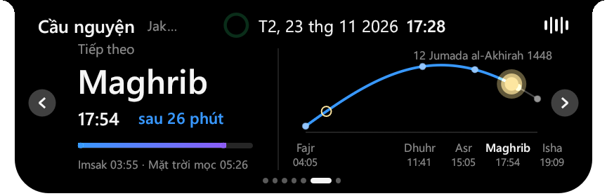

- Turn it on in Settings › Prayer times. 84 Indonesian cities, 28 world cities (local time, with daylight
  saving) and **My location** (Windows location).
- 11 calculation methods (Kemenag, MWL, ISNA, Egypt, Umm al-Qura, Karachi, JAKIM, MUIS, Diyanet, UOIF,
  Gulf) or by city; Asr by the method, Shafi'i or Hanafi.
- The next prayer and time left, Imsak and sunrise, the **Hijri date**, an arc with the 5 prayers and
  the sun. Prayer names follow the app's language.
- A reminder on time and 10 minutes before (a missed one is made up within 30 minutes), music pauses by
  itself and can resume after 10 minutes, each prayer can be shifted ±10 minutes.

### 🧩 Widgets

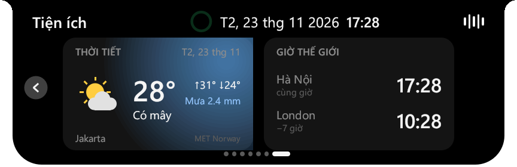

Two widgets at a time, chosen from 10 in Settings › Widgets: **This week, Battery, Next prayer, Focus
today, World clock, Moon, Countdown, Water, Weather, Devices**. Click the This week, Next prayer, Focus or Water
widget to open its page.

<details>
<summary><b>Widget details</b></summary>

- **World clock:** 2 of 27 cities (including Hanoi, Ho Chi Minh City, Bangkok…), with the time difference
  from this PC.
- **Countdown:** New Year, Ramadan, Eid al-Fitr, Eid al-Adha, Indonesian Independence Day, Christmas,
  **Lunar New Year (Tết)**, **Vietnam National Day**, or **your own day** (your name for it, DD/MM every
  year or DD/MM/YYYY).
- **Weather** (MET Norway, read again every 30 minutes): temperature, sky, today's high/low, rain in the
  next 6 hours, °C or °F.
- **Devices:** up to three connected Bluetooth devices (headsets, mice, keyboards, controllers)
  and Xbox controllers, with their battery; red when low.
- **Week starts on:** Sunday or Monday.

</details>

### 📰 Today

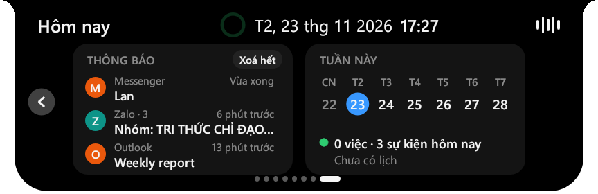

- Turn it on in Settings › Notifications › Today page (or Settings › Pages).
- Left: up to 20 recent notifications, scrollable, **one line per app** with its logo and count
  ("Zalo · 3"); click to open the app that sent it, right-click to remove, Clear removes them all. Kept in
  memory only, gone when the app closes.
- Right: this week, today's task and Google Calendar event count, the next task or event.

## System pop-ups

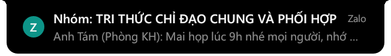

Turn each kind on or off in **Settings › Popups**.

| Pop-up | When |
|---|---|
| 🔊 Volume · ☀️ Brightness | When the level changes |
| ⇪ Caps Lock · ⌨️ Keyboard language | When turned on/off, when the keyboard changes |
| 🔋 Battery | Charger plugged in / out, low battery (15 / 20 / 30%, your choice), very low (under 11%), fully charged; on battery, the pop-up and the Battery widget show the time left |
| 📶 Wi-Fi | Connected, disconnected, connected without internet |
| 🎧 Bluetooth devices · 🎮 Xbox controllers | Headsets, mice, keyboards, controllers: connected (with battery %), disconnected, battery low |
| 🎵 Now playing | Song changes while the notch is shrunk |
| 🔔 Windows notifications | App logo, sender and text (if previews are on), "+N" for more; click to open the right app |

## Quick tools

### 💬 Ask Nusa — `Ctrl + Alt + Space`

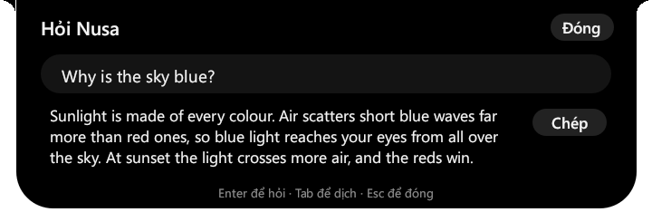

| Type | You get |
|---|---|
| `12*(3+4)=` | **Calculated at once** when you type `=` (or Enter), no internet needed. `+ − × ÷ ^ %`, brackets, negative numbers. |
| `1.000.000 / 4`, `2,500,000 + 1`, `1,5 * 2` | Thousands separators and decimal marks, in both Vietnamese and English style. |
| `500k`, `2tr`, `2 triệu`, `1 tỷ` | Vietnamese shorthand for large amounts (thousand, million, billion). |
| `100usd to vnd=`, `500k vnd to usd`, `1,5 eur in jpy` | **Currency conversion** (Enter adds the `=`); rates are kept for 12 hours. |
| Any question + **Enter** | Asks **Gemini**, at most 3 short sentences, in the language of the question. |
| Any text + **Tab** | **Translates** into the app's language (text already in that language goes into English). |

- The **Copy** button copies the result or the answer; **↑ / ↓** bring back earlier questions (up to 20,
  in memory only); **Esc** closes.
- Asking Gemini and translating need your own Gemini key (free at
  [aistudio.google.com/apikey](https://aistudio.google.com/apikey)), pasted into Settings › Ask Nusa; the
  key is encrypted on this PC. A wrong key, too many requests or no internet are all clearly reported.

### 🔍 Grab text from the screen — `Ctrl + Alt + T`

The screen freezes; drag over an area and its text is copied ("Copied N characters"); **Esc** or
right-click cancels. Read right on this PC, no internet needed, in the languages installed in Windows (to
read a language, install its language pack in Settings › Time & language › Language).

**App languages:** English, Tiếng Việt, 中文 (简体), Français.

## General settings

Right-click the notch to open, **Esc** or **Close** to close. Every change is saved at once and kept after
a restart.

| Item | Choices |
|---|---|
| Language | English, Tiếng Việt, 中文 (简体), Français (the first time, follows the Windows language) |
| Start with Windows | Shows the real state, even when turned off from Task Manager; re-points itself when the app moves |
| Size | Small 100% · Medium 115% · Large 130% · Extra large 150% |
| Show date and time | Hides the clock on the notch and at the top of pages (a running Pomodoro still shows) |
| Tray icon | Violet · Neon dark · Classic light |
| Minimal notch · Mascot | On/off (also in the tray menu) |
| Reduce motion | No sliding, springing or popping (the first time, follows Windows' Animation effects) |
| Open the notch on | Hover · Click |
| Status ring | Water · Tasks done today · No ring |
| Reminder sounds | Chime for Pomodoro, To-do, Water |
| Pages | ↑ ↓ to reorder, switch to hide (at least 1 page always stays) |
| Data | **Open** the data folder · **Restore** default settings (tap twice; water, tasks, history, keys and calendar are kept) · **Check** for a new version on GitHub (or once a day, off by default) |

Data lives in `%LOCALAPPDATA%\MyNotch`: `settings.txt`, `water.txt`, `water_log.txt`, `tasks.txt`,
`focus.txt`, `shelf.txt`, `notes.txt`, `clipboard.txt` (only with "Remember after restart" on). The Gemini key and the
calendar address are kept apart in `gemini.key` and `calendar.key`, encrypted with Windows DPAPI.

## Performance

The notch draws only when something changes (a Windows event, the next minute, the mascot's blink), so
it barely touches your PC.

| State | CPU | Memory (Task Manager) |
|---|---|---|
| Resting (notch shrunk) | ~0 % | about 20–30 MB |
| Open | under 1 % | up to about 65 MB, back down once it closes |

<sub>Measured on one PC with the release build after 6 hours of running. Memory grows a little with
cover art and app logos.</sub>

## Installation

1. Download `MyNotch-<version>-windows-x64.zip` from **[Releases](https://github.com/PhamDoanTrungDuong/Dynamik/releases/latest)**.
2. Unzip it and double-click **`install.cmd`** (no admin rights needed). The app is copied to
   `%LOCALAPPDATA%\Programs\MyNotch` and a "My Notch" shortcut is added to the Start Menu.
3. If Windows shows *"Windows protected your PC"*: click **More info → Run anyway** (the app is not
   code-signed yet).

> **Verify a download:** each release has a `SHA256SUMS.txt`; compare it with
> `(Get-FileHash MyNotch-<version>-windows-x64.zip).Hash` in PowerShell.
>
> **Update:** quit the running notch (tray icon › Exit), then run the new version's `install.cmd`.
>
> **Uninstall:** run `%LOCALAPPDATA%\Programs\MyNotch\uninstall.cmd`. Your settings live in
> `%LOCALAPPDATA%\MyNotch`; delete that folder to remove everything.

## Network and privacy

The app runs entirely on your PC except for the features below; each one only connects when you use it.

| Feature | Sends to | What |
|---|---|---|
| Lyrics | [LRCLIB](https://lrclib.net) | Song title and artist |
| Weather | [MET Norway](https://api.met.no) | The chosen city's coordinates (rounded to ~1 km) |
| Currency | [open.er-api.com](https://open.er-api.com) | Nothing but the rates request |
| Ask Nusa / Translate | Google Gemini | The question or text to translate, with your key |
| Google Calendar | Google | Reads your calendar through your secret iCal address |
| Updates | GitHub | Asks for the latest release, only when you check (or once a day if turned on) |

- 🔐 The Gemini key and the calendar address are **encrypted by Windows** (DPAPI); only this Windows
  account on this PC can read them.
- 📋 The clipboard never keeps passwords; notifications on the Today page stay in memory only.
- ⌨️ To show the Caps Lock / keyboard language pop-ups, the app watches those keys (key codes only,
  nothing is recorded); some antivirus software may warn about this.

## Building from source

You need [Rust](https://rustup.rs) (stable, target `x86_64-pc-windows-msvc`).

```sh
cd app
cargo build --release      # app/target/release/notch.exe
cargo test --release
```

<details>
<summary><b>Icon and release packaging</b></summary>

- The exe's icon is embedded with `windres` (for example from LLVM-MinGW) when it is on PATH; without it
  the exe still builds, just without an icon. Icon drafts are in `icon-options/`.
- Packaging: copy `app/target/release/notch.exe` as `MyNotch.exe` into a `MyNotch/` folder together with
  the three files in `packaging/` (`install.cmd`, `uninstall.cmd`, `HUONG-DAN.txt`), then zip that folder
  as `MyNotch-<version>-windows-x64.zip`.

</details>

---

<div align="center">
<sub>An independent rebuild inspired by the Nusa app; not affiliated with Nusa's author.
<code>app/MECHANICS.md</code> (in Vietnamese) records how each feature works.</sub>
</div>
