<div align="center">

<a href="README.md">English</a> · <a href="README.vi.md">Tiếng Việt</a> · <b>简体中文</b> · <a href="README.fr.md">Français</a>

# Dynamik — My Notch

**适用于 Windows 10/11 的"灵动岛"式刘海。**
它停靠在屏幕顶部边缘，显示正在发生的事情，展开后是一个小工具面板。

*使用 Rust (egui) 编写。*

[](https://github.com/PhamDoanTrungDuong/Dynamik/releases/latest)


**[⬇ 下载最新版本](https://github.com/PhamDoanTrungDuong/Dynamik/releases/latest)**

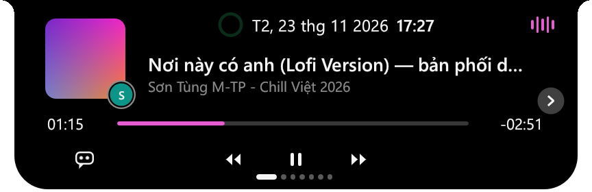

</div>

---

## 目录

- [亮点](#亮点)
- [快速上手](#快速上手)
- [页面](#页面)
- [系统弹窗](#系统弹窗)
- [快捷工具](#快捷工具)
- [通用设置](#通用设置)
- [性能](#性能)
- [安装](#安装)
- [网络与隐私](#网络与隐私)
- [从源码构建](#从源码构建)

## 亮点

| | |
|---|---|
| 🎵 **Music** | 真实专辑封面、随歌曲滚动的歌词、取自封面的颜色 |
| ⏱️ **Pomodoro** | 4 轮、跳过、自动继续、专注免打扰 |
| 💧 **Water** | 在设定时段内提醒喝水、撤销、60 天记录 |
| 📁 **Shelf & Clipboard** | 暂存文件和复制的文字，可拖进聊天框；从不保存密码 |
| ✅ **To-do & Google 日历** | 定时任务、今天的日历事件、提前 10 分钟提醒 |
| 📝 **Note** | 快速工作便签：置顶、标记完成、复制或拖出，`Ctrl + Alt + N` |
| 🕌 **Prayer** | 11 种算法的礼拜时间、太阳弧线、伊斯兰历日期 |
| 🧩 **Widgets** | 天气、世界时钟、倒数日（含春节）、电池、月相… |
| 🔔 **弹窗** | 音量、电池、Wi-Fi、耳机、正在播放、Windows 通知 |
| 💬 **问 Nusa** | 计算器、货币换算、问 Gemini、翻译、提取屏幕文字 |

## 快速上手

| 想要… | 这样做 |
|---|---|
| 打开刘海 | 鼠标悬停在刘海上（或点击，见 Settings › Open the notch on） |
| 切换页面 | 两侧箭头、页面圆点、鼠标滚轮 / 触摸板滑动，或 ← → 键 |
| 打开设置 | 右键点击刘海（再右键一次关闭） |
| 提问、计算、翻译 | `Ctrl + Alt + Space` |
| 提取屏幕文字 (OCR) | `Ctrl + Alt + T`，然后拖选一块区域 |
| 写一条便签 | `Ctrl + Alt + N` |
| 托盘菜单 | 右键托盘图标：Start with Windows、Mascot、Minimal notch、About、Exit |

<table>
<tr>
<td align="center"><br><sub>播放音乐时缩小</sub></td>
<td align="center">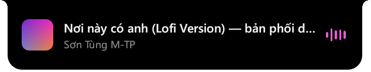<br><sub>换歌时的"正在播放"弹窗</sub></td>
</tr>
</table>

<details>
<summary><b>静止的刘海、吉祥物和各种模式</b></summary>

- **吉祥物：** 两只带光晕的白色眼睛，大约每 4 秒眨一次；下半部分有青、蓝、紫色的光带，沿着刘海圆角。
- **Minimal notch：** 没有任何事情时（无吉祥物、无番茄钟、无音乐），刘海缩成一条细线；鼠标悬停即展开。
- **播放音乐时：** 缩小的刘海显示小封面、时间和封面颜色的声波，代替吉祥物。
- **番茄钟运行时：** 静止的刘海显示紫色倒计时。
- 鼠标离开后刘海自动收起，正在输入文字时除外。
- **全屏时隐藏**（游戏、视频、幻灯片），退出全屏后重新出现；可在 Settings › Popups 中关闭。
- **首次打开：** 刘海会打招呼，并说明如何打开和进入设置。快捷键被其他应用占用时会提示；状态见 Settings › General。
- **只运行一个实例：** 再次打开 exe 会展开正在运行的刘海，不会出现第二个。

</details>

## 页面

在 **Settings › Pages** 中调整页面顺序或隐藏页面。

### 🎵 Music

- 来自支持 Windows 媒体控制的播放器（Spotify、浏览器…）的当前歌曲：**真实专辑封面**、歌名、歌手 – 专辑、时间。
- 播放应用的图标位于封面角落；同时打开多个播放器时，点击图标切换。
- 播放/暂停、上一首/下一首（没有上一首/下一首的播放器，例如单个 YouTube 视频，这两个按钮改为后退/前进 10 秒），点击或拖动进度条跳转。进度条和声波取封面颜色。
- **随歌曲滚动的歌词**（LRCLIB），点击某一行即跳到该处。用页面上的歌词按钮开关，或在 Settings › Music 中彻底关闭。

### ⏱️ Pomodoro

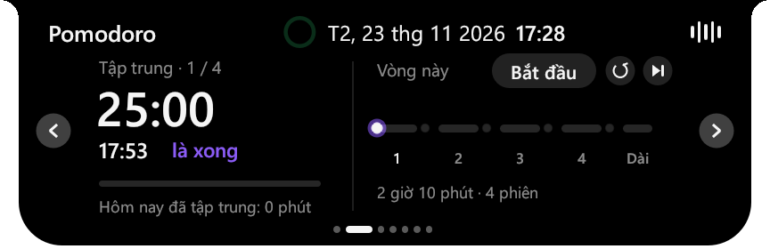

- Start / Pause / Resume（或 **空格** 键），4 轮专注后长休息，各轮之间短休息。
- **↺** 重新开始当前阶段（未运行时：从第 1 轮重新开始）；**▶|** 跳到下一阶段。
- 时间到时弹出 Break / Focus 并响铃（如已开启）。页面显示结束时间、4 轮进度条和今天的专注分钟数。
- Settings › Pomodoro：各阶段时长、**自动继续**、**专注免打扰**（通知等到专注时间结束再显示）。
- 新的一天轮数归零；电脑睡眠时计时暂停。

### 💧 Water

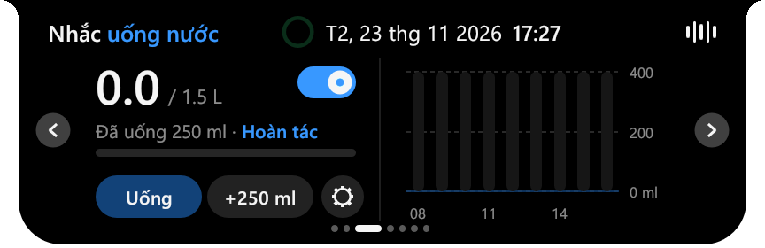

- 进度条和"今天 · 45% · 下次 14:30"这样的一行文字、按小时的柱状图、提醒开关。
- **喝水**（按目标和提醒次数平均分配的量）和 **+250 ml**（一杯）；刚点完 10 秒内可 **撤销**。
- 齿轮按钮：目标 1–4 L（每步 0.25 L）、水瓶容量、提醒时段、Reset（3 秒内点两次）。
- 提醒弹窗有 Drank / Snooze（5 / 10 / 15 分钟）；水瓶快空时提醒加满（Refilled）。错过一次提醒会在下一次之前补提醒。
- 每天的饮水量保存 60 天；Water 小组件显示最近 7 天。

### 📁 Shelf 和 Clipboard

- **Shelf：** 把文件拖到刘海任意位置；点击打开，拖出到文件夹或聊天框，右键移除，Clear 全部清除。文件多时横向滚动；已移动或删除的文件显示为灰色。
- **Clipboard**（角落的切换按钮）：复制文字的历史，保留 1–5 条；点击再次复制，拖进聊天框，右键删除单条。
- 🔒 **密码** 以及被密码管理器标记为"不保留历史"的内容 **永远不会被保存**。

### ✅ To-do 和 Google 日历

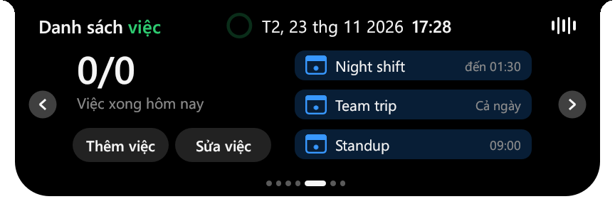

- 可设时间（HH:MM，不设时间则留空）和时长的任务；点击标记完成（按天计，新的一天重新打开）；用 "Edit Task" 修改或删除。
- 开始和结束时提醒，每天一次，带 **Later** 按钮（5 / 10 / 15 分钟）。
- **Google 日历：** 把日历的 *Secret address in iCal format*（iCal 格式的私密地址）粘贴到 Settings › Google Calendar（已加密，只保存在本机）。今天的事件显示在 To-do 顶部（只读），提前 10 分钟（可关闭）和开始时提醒；支持重复事件、改期或取消的场次、跨夜事件。每 15 分钟重新读取一次。

### 📝 Note

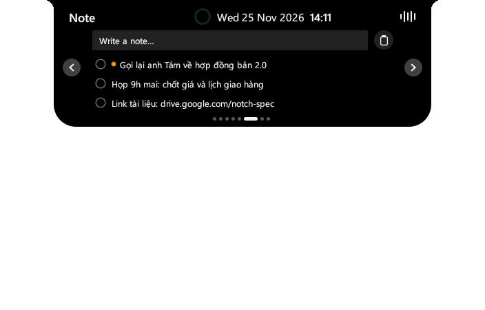

- 输入便签后按 **回车**；输入框旁的按钮把刚复制的文字存为便签（与 Clipboard 一样，不收取标记为隐私的内容）。
- **点击** 便签即复制，**拖动** 到聊天框或文件夹，点击 **圆圈** 标记完成（加删除线，3 天后自动删除）；**右键** 置顶、完成或删除。
- 在任何地方按 **`Ctrl + Alt + N`** 打开此页，光标已在输入框中。
- 置顶的在最前，其次是最新的；最多 200 条，每条最多 500 个字符，保存在 `notes.txt`。

### 🕌 Prayer

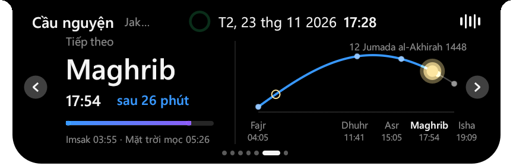

- 在 Settings › Prayer times 中开启。84 个印度尼西亚城市、28 个世界城市（当地时间，含夏令时）以及 **My location**（Windows 定位）。
- 11 种计算方法（Kemenag、MWL、ISNA、Egypt、Umm al-Qura、Karachi、JAKIM、MUIS、Diyanet、UOIF、Gulf）或按城市；晡礼 (Asr) 按方法、Shafi'i 或 Hanafi。
- 下一次礼拜及剩余时间、Imsak 和日出时间、**伊斯兰历日期**、标有 5 次礼拜和太阳的弧线。礼拜名称跟随应用语言。
- 准时和提前 10 分钟提醒（错过的在 30 分钟内补提醒），自动暂停音乐并可在 10 分钟后恢复播放，每次礼拜可单独调整 ±10 分钟。

### 🧩 Widgets

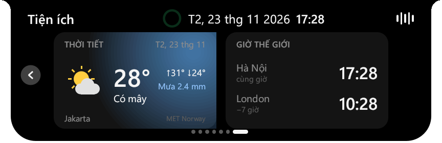

同时显示两个小组件，在 Settings › Widgets 中从 9 种里选择：**This week、Battery、Next prayer、Focus today、World clock、Moon、Countdown、Water、Weather**。点击本周、礼拜、专注或喝水小组件可打开对应页面。

<details>
<summary><b>各小组件详情</b></summary>

- **World clock：** 从 27 个城市中选 2 个（含河内、胡志明市、曼谷…），并显示与本机的时差。
- **Countdown：** 新年、斋月、开斋节、宰牲节、印度尼西亚独立日、圣诞节、**春节 (Tết)**、**越南国庆节**，或 **你自己的日子**（自定名称，每年 DD/MM 或 DD/MM/YYYY）。
- **Weather**（MET Norway，每 30 分钟重新读取）：温度、天空状况、今天最高/最低温、未来 6 小时降雨，°C 或 °F。
- **Week starts on：** 周日或周一。

</details>

### 📰 Today

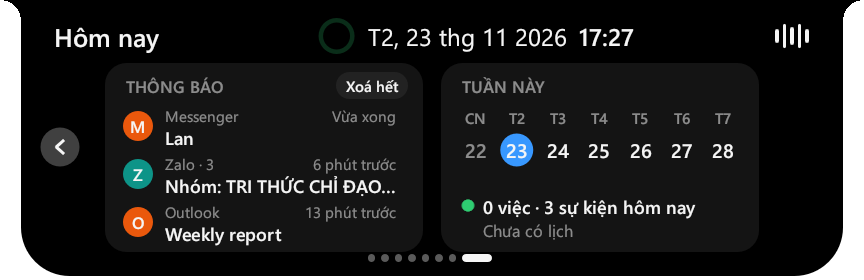

- 在 Settings › Notifications › Today page（或 Settings › Pages）中开启。
- 左侧：最多 20 条最近通知，可滚动，**每个应用一行**，带图标和数量（"Zalo · 3"）；点击打开发送通知的应用，右键删除，Clear 全部清除。只保存在内存中，关闭应用即消失。
- 右侧：本周、今天的任务数和 Google 日历事件数、下一个任务或事件。

## 系统弹窗

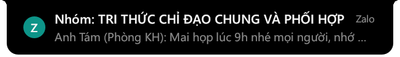

在 **Settings › Popups** 中逐项开关。

| 弹窗 | 何时出现 |
|---|---|
| 🔊 音量 · ☀️ 亮度 | 调整时 |
| ⇪ Caps Lock · ⌨️ 键盘语言 | 开/关时、切换键盘时 |
| 🔋 电池 | 插上 / 拔下充电器、电量低（15 / 20 / 30%，可选）、电量极低（低于 11%）、充满 |
| 📶 Wi-Fi | 已连接、已断开、已连接但无法上网 |
| 🎧 蓝牙耳机 | 已连接（附电量 %）、已断开、耳机电量低 |
| 🎵 正在播放 | 刘海缩小时换歌 |
| 🔔 Windows 通知 | 应用图标、发送者和内容（如已开启预览），合并为 "+N"；点击打开对应应用 |

## 快捷工具

### 💬 问 Nusa — `Ctrl + Alt + Space`

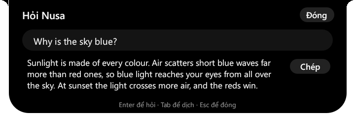

| 输入 | 结果 |
|---|---|
| `12*(3+4)=` | 输入 `=`（或回车）**立即计算**，无需联网。支持 `+ − × ÷ ^ %`、括号、负数。 |
| `1.000.000 / 4`、`2,500,000 + 1`、`1,5 * 2` | 识别越南式和英式的千位分隔符与小数点。 |
| `500k`、`2tr`、`2 triệu`、`1 tỷ` | 识别越南语的大额简写（千、百万、十亿）。 |
| `100usd to vnd=`、`500k vnd to usd`、`1,5 eur in jpy` | **货币换算**（回车自动补 `=`）；汇率保留 12 小时。 |
| 任意问题 + **回车** | 询问 **Gemini**，最多 3 句简短回答，语言与问题相同。 |
| 任意文字 + **Tab** | **翻译** 成应用的语言（已是该语言的文字则译成英语）。 |

- **复制** 按钮复制结果或回答；**↑ / ↓** 调出之前的问题（最多 20 条，只在内存中）；**Esc** 关闭。
- 问 Gemini 和翻译需要你自己的 Gemini 密钥（在 [aistudio.google.com/apikey](https://aistudio.google.com/apikey) 免费获取），粘贴到 Settings › Ask Nusa；密钥在本机加密保存。密钥错误、请求过多或断网都会明确提示。

### 🔍 提取屏幕文字 — `Ctrl + Alt + T`

屏幕定格，拖选一块区域，其中的文字就会被复制（并提示"已复制 N 个字符"）；**Esc** 或右键取消。在本机直接识别，无需联网，支持 Windows 中已安装的语言（要识别某种语言，请在 Settings › Time & language › Language 中安装对应语言包）。

**界面语言：** English、Tiếng Việt、中文 (简体)、Français。

## 通用设置

右键点击刘海打开，**Esc** 或 **Close** 关闭。所有更改立即保存，重启应用后仍然保留。

| 项目 | 选项 |
|---|---|
| Language | English、Tiếng Việt、中文 (简体)、Français（首次跟随 Windows 语言） |
| Start with Windows | 显示真实状态，包括在任务管理器中关闭的情况；应用移动位置后自动重新指向 |
| Size | Small 100% · Medium 115% · Large 130% · Extra large 150% |
| Show date and time | 隐藏刘海上和页面顶部的时钟（运行中的番茄钟仍显示） |
| Tray icon | Violet · Neon dark · Classic light |
| Minimal notch · Mascot | 开/关（托盘菜单中也有） |
| Open the notch on | 悬停 · 点击 |
| Status ring | Water · 今天完成的任务 · 不显示 |
| Reminder sounds | 番茄钟、To-do、喝水的提示音 |
| Pages | ↑ ↓ 调整顺序，开关隐藏（始终至少保留 1 页） |
| 数据 | **打开** 数据文件夹 · **恢复** 默认设置（点两次；饮水、任务、历史、密钥和日历会保留） |

数据位于 `%LOCALAPPDATA%\MyNotch`：`settings.txt`、`water.txt`、`water_log.txt`、`tasks.txt`、`focus.txt`、`shelf.txt`、`notes.txt`、`clipboard.txt`（仅在开启 "Remember after restart" 时）。Gemini 密钥和日历地址单独保存在 `gemini.key` 和 `calendar.key` 中，使用 Windows DPAPI 加密。

## 性能

刘海只在有变化时才重绘（Windows 事件、到了新的一分钟、吉祥物眨眼），几乎不占用电脑资源。

| 状态 | CPU | 内存（任务管理器） |
|---|---|---|
| 空闲（刘海缩小） | 约 0 % | 约 20–30 MB |
| 展开 | 低于 1 % | 最多约 65 MB，收起后回落 |

<sub>在一台电脑上用 release 版运行 6 小时后测得。有专辑封面和应用图标时内存会略有增加。</sub>

## 安装

1. 在 **[Releases](https://github.com/PhamDoanTrungDuong/Dynamik/releases/latest)** 页面下载 `MyNotch-<version>-windows-x64.zip`。
2. 解压后双击 **`install.cmd`**（无需管理员权限）。应用会被复制到 `%LOCALAPPDATA%\Programs\MyNotch`，并在开始菜单中添加 "My Notch" 快捷方式。
3. 如果 Windows 显示 *"Windows protected your PC"*：点击 **More info → Run anyway**（应用尚未进行代码签名）。

> **更新：** 退出正在运行的刘海（托盘图标 › Exit），然后运行新版本的 `install.cmd`。
>
> **卸载：** 运行 `%LOCALAPPDATA%\Programs\MyNotch\uninstall.cmd`。你的设置在 `%LOCALAPPDATA%\MyNotch`，删除该文件夹即可彻底清除。

## 网络与隐私

除以下功能外，应用完全在本机运行；每项功能只在你使用时才联网。

| 功能 | 发送到 | 发送内容 |
|---|---|---|
| 歌词 | [LRCLIB](https://lrclib.net) | 歌名和歌手 |
| 天气 | [MET Norway](https://api.met.no) | 所选城市的坐标（约 1 km 精度） |
| 货币换算 | [open.er-api.com](https://open.er-api.com) | 仅汇率请求本身 |
| 问 Nusa / 翻译 | Google Gemini | 问题或要翻译的文字，以及你的密钥 |
| Google 日历 | Google | 通过你的私密 iCal 地址读取日历 |

- 🔐 Gemini 密钥和日历地址 **由 Windows 加密**（DPAPI），只有本机上的这个 Windows 账户能读取。
- 📋 剪贴板从不保存密码；Today 页面的通知只保存在内存中。
- ⌨️ 为了显示 Caps Lock / 键盘语言弹窗，应用会监听这些按键（只看按键代码，不记录任何内容）；部分杀毒软件可能因此发出警告。

## 从源码构建

需要 [Rust](https://rustup.rs)（stable，目标 `x86_64-pc-windows-msvc`）。

```sh
cd app
cargo build --release      # app/target/release/notch.exe
cargo test --release
```

<details>
<summary><b>图标和发布打包</b></summary>

- 如果 PATH 中有 `windres`（例如来自 LLVM-MinGW），会用它嵌入 exe 图标；没有也能构建，只是没有图标。图标草稿在 `icon-options/` 中。
- 打包：把 `app/target/release/notch.exe` 复制为 `MyNotch.exe`，与 `packaging/` 中的三个文件（`install.cmd`、`uninstall.cmd`、`HUONG-DAN.txt`）一起放进 `MyNotch/` 文件夹，然后压缩为 `MyNotch-<version>-windows-x64.zip`。

</details>

---

<div align="center">
<sub>受 Nusa 应用启发的独立重制版；与 Nusa 的作者无关。
<code>app/MECHANICS.md</code>（越南语）记录了每项功能的工作方式。</sub>
</div>
